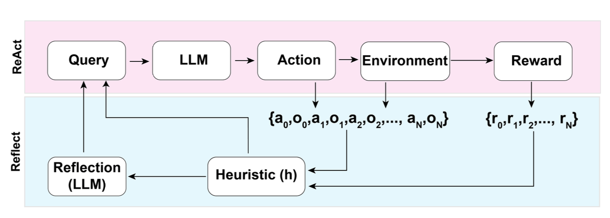
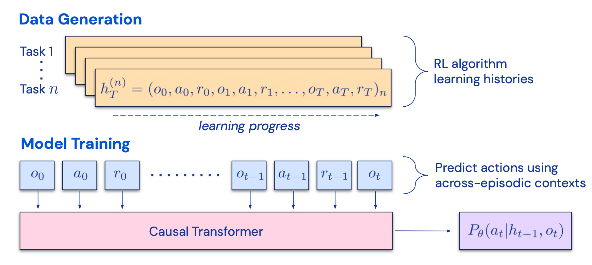
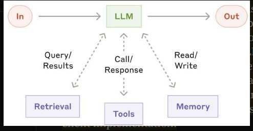
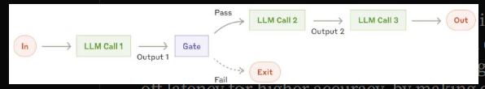
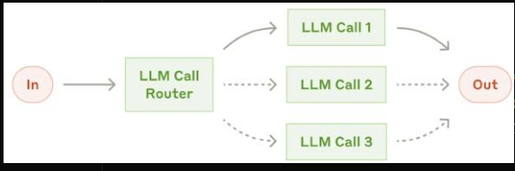
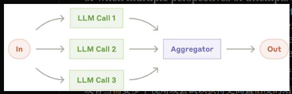
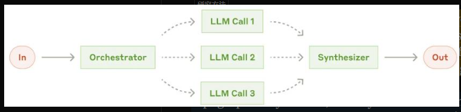
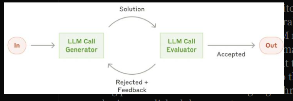
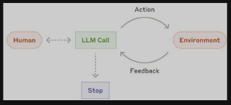
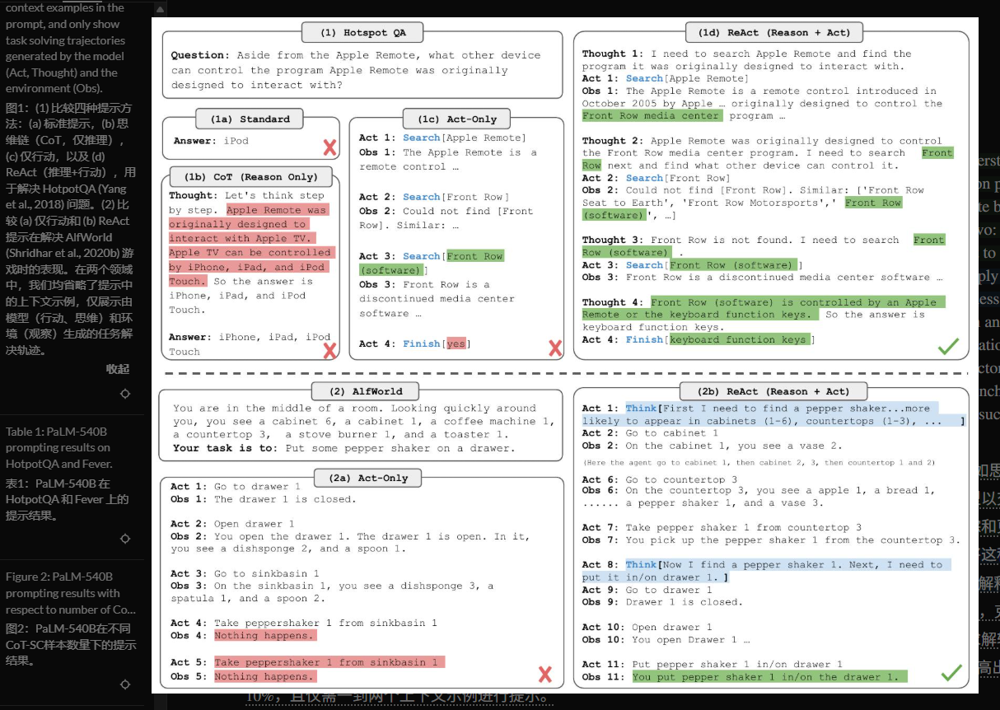

# 2026年9月28日

基本概念

## Blog：LLM Powered Autonomous Agents, from June 2023

llm是agent的决策者，完成任务分解与反思改进、长短程记忆、工具调用；接下来分步讲解

planning，可以参考的工作有：
CoT：think-step-by-step，分解任务并给出推理步骤，本质是一种prompt-engineer，即在prompt中加入包含推理步骤提示的示例；仍然是一次llm调用出结果
ToT：思维树，每步探索多种可能性并用classifier选一个最好的或majority-vote；需要多次调用llm
LLM+P：利用llm转化问题，使用经典的规划器生成步骤并转换回自然语言prompt
ReAct：要求llm按照Thought-Action-Observation格式输出，并约束action必须是预定义的api且真的去执行，反复运行这个过程的framework
Reflexion：在ReAct基础上，每用动作prompt生成action和obs，就判断任务完成与否r，如果没有完成，则判断是否执行陷入卡顿h，如果陷入卡顿就暂停动作生成的loop，并用两个固定的示范反思记录+本次失败的动作轨迹作反思prompt要求llm输出失败记录和改进计划；之后恢复任务状态并在动作prompt中使用最近至多三个失败记忆生成动作

CoH：对llm模型sft，收集若干同一任务多个执行结果(x任务描述,y是llm输出,r输出评分,z输出的文字评价)数据，将数据按r升序排列，组织为(x,zj,yj,...,zn,yn)将x-zn输入prompt，要求最大化输出yn的似然函数【逐token的概率】；希望这样sft后模型能够学会从差答案改进为好答案
Algorithm-Distillation：将上述方法应用到ReAct动作序列的生成，以(o,a,r)为历史预测a并最大化似然函数；具体来说，使用经典强化学习算法学习特定任务的policy并保留(o,a)历史记录，再用这些history用于训练llm得到任务无关的能力

Memory：如何获取、存储、搜索使用记忆；这里理解为embedding、context和外部vector三种记忆，分别对应从短到长的使用时间
这里主要介绍使用MIPS作查找目标，ANN作为算法的不同实现

Tool-use：llm调用tool实现功能
以huggingGPT为例，使用少量demostration配合prompt要求llm提供任务分解，llm接受任务并从prompt提供的工具列表中选择api生成json给解析器调用，记录工具运行结果并描述执行和推理过程，汇报结果
API-BANK：一个tool-augmented-llm的评测benchmark，提供大量api和任务要求

常见的局限性：context-length有限即llm接受的输入窗口有限、长期规划和任务分解不可靠、llm输出调用工具的api接口格式不可靠

## Document：How we build claude managed agents

讨论怎样把 Agent 做成能够长时间运行、出故障后恢复、并且方便升级的服务；managed-agent是Anthropic提供的服务，接受agent配置和任务数据，在自己的执行环境中运行并返回结果；这是用于开发者把agent接入自己的应用

将agent的各个部分【harness、session/memory、tool&sandbox】拆分，这是为了避免sandbox挂了把harness和session也丢掉，具体来说就是把harness运行环境独立于tool-use环境，session也记录在容器之外
设计了一套接口用于agent不同组件通信，和对应的工作流程；

## Document：Agnets and workflow

认为workflow通过固定的代码编排llm与tool，agent使用llm动态引导自己和tool-use；下面从llm开始不断添加组件达到agent

augmented-LLM：允许retrieval、tool-call和memory-rw的以增强output的llm；
workflow：包括若干种编排手段：prompt-chain通过分拆task且每个subtask调用llm实现，来达到更高的准确性【相比单次执行】；；router将不同问题路由到不同能力、prompt和tool-use的模型；parallelization将任务拆分为不同段或并行运行多次vote最好结果；orchestrator由llm动态分解任务并delegate到不同模型；evaluator-optimizer两个llm反复generate和evaluate直到结果足够好
agent：强调与环境和人类指令互动并最终结束

本文意思是，应当针对不同的任务类型选择不同的aug-llm调用流程设计，根据问题设计llm调用流程；workflow对处理结构明确的任务应用，固定各部分流程和功能，可变的只有输入数据；对于执行路径难以预先确定的任务使用agent，agent让用户提供目标，模型决定下一步做什么并最终给出结果

## Paper：ReACT

要求llm推理时输出thought-action和执行后的obs，且每次在上次的t/a/o基础上重新运行直到输出结果

## Timeline

23prompt-engineer、24rag&SFT、25agent、26rl&wm
