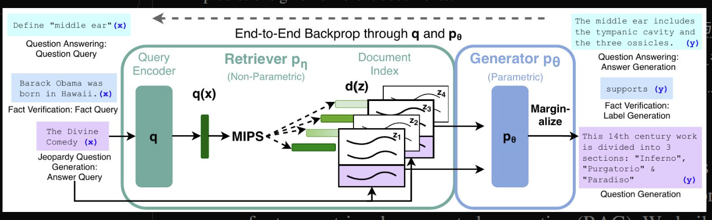

# 2026年10月10日

记忆与上下文

## LangChain memory [https://docs.langchain.com/oss/python/langchain/overview]

> Agent = Model + Harness，The harness is everything around the model loop: the prompt, the tools, and any middleware that shapes behavior.

Short-term-memory是context，是conversation相关的，常常体现为对话的state
Long-term-memory的常用实现方法，trim-old-message、summarize、filter等，体现为文件或数据库内容

## RAG: 可溯源的知识，结合参数化和非参数化存储

提出RAG模型，参数化内容是seq2seq，非参数化存储是百科的稠密向量和检索器
以往工作seq2seq基本处理从文档中抽取答案的问题[且知识库难以更新，需要重新微调]，通过参数化与非参数化生成结合解决以上问题

架构上两部分，一个参数为η的检索器pη(z|x)，它根据查询x返回文本段落的（前K个截断）分布；一个参数为θ的生成器pθ(yi|x, z, y1:i−1)，它基于前i-1个标记的上下文y1:i−1、原始输入x以及检索到的段落z来生成当前标记
两种方法利用文档，seq2seq时每个token相同文档，meigetoken不同文档

RAG-Sequence-Model：检索top-K文档，分别计算根据这k篇文档逐token生成完整答案的概率，再检索器概率加权求和
RAG-Token-Model：使用top-k文档预测下个token的概率，求他们的加权和，这样进行N次得到的概率连乘

检索器与生成器
检索器是基于BERT的最大内积搜索，pη(z|x)正比于exp(d(z)T\*q(x)),d()q()分别是基于BERT的预训练编码器，来自DRP
生成器可以使用任何encode-decode架构，这里使用BART的seq2seq的transformer模型，拼接输入与检索到的问题
使用最小化负对数似然训练

推理时为了获取总体概率最大的答案，采用beam-search
逐个token的RAG可以用一个beam-search完成；seq的beam-search在每个文档上做，并考虑他们的并集中跨文档的加权生成概率最高的top-k

## MemGPT; 参考虚拟内存，扩展llm的上下文窗口

MemGPT为llm提供若干可调用的函数，来操作管理外部上下文
将prompt-context分为三部分，固定的系统提示词、工作上下文[用于emGPT提供长期重要信息，配合archival-db]、FIFO消息队列[存储用户对话和retrieve得到的消息，recall-storage]

llm流式生成函数调用，补充结果到尾部，并决定是否继续调用函数还是yield返回结果
