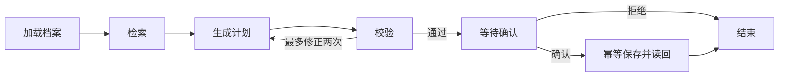

# 第 5 章：用 LangGraph 实现可恢复的学习助手

本章聚焦一个框架、一条完整业务流程：加载学习档案 → 检索 → 生成三天计划 → 校验 → 等待确认 → 保存并读回。

本章提供两个独立实践：LangGraph 学习状态图、确认和持久化恢复；OpenAI Agents SDK 学习模型驱动的工具调用与计划生成。不包含 baseline 对照、评测脚本或功能测试。

## 运行

在仓库根目录使用 `agent-learn` 环境：

```powershell
conda activate agent-learn
python -m pip install -r p5_agent_framework/practice/requirements.txt
.\scripts\practice.ps1 5 run --provider offline
```

默认输入在 `data/input.json`，可修改问题、检索词、`profile.minutes_per_day`、已学内容和 `start_date`。offline 是无需密钥的演示模型；实际检索、LangGraph 节点、校验和存储照常执行。

真实模型入口：

```powershell
.\scripts\practice.ps1 5 run --provider deepseek
```

密钥从 `DEEPSEEK_API_KEY` 或被 Git 忽略的 `api-key.txt` 读取。该模式会向 DeepSeek 发送问题、学习档案和检索片段，使用可取消的异步 HTTP 请求。

## 确认与恢复

正常运行到确认节点后，`run()` 会在终端显示会话 ID 和候选计划，并询问 `是否确认保存该计划？[y/n]`。输入 `y` 后自动恢复同一会话、保存并返回 `completed`；输入 `n` 后恢复并返回 `rejected`。不需要再启动一次程序。

如果在确认前关闭了程序，仍可将下面内容保存为 `p5_agent_framework/practice/artifacts/resume.json`，替换为终端显示的会话 ID，从检查点恢复：

```json
{"session_id":"实际会话 ID","resume":true,"decision":true}
```

```powershell
.\scripts\practice.ps1 5 run --provider offline --input p5_agent_framework/practice/artifacts/resume.json
```

恢复请求中 `decision:true` 保存，`false` 拒绝；`null` 或省略则回到终端确认提示。新建时传入的决定不会提前批准尚未生成的计划。已结束会话重复恢复不重复写入。

可在新建输入加入 `"stop_after":"retrieval"`，在检索后暂停；或使用 `"stop_after":"save"`，在保存节点完成后暂停。关闭进程后，用同一 session_id、`resume:true`、`decision:null` 继续。确认恢复时无需重新提供问题和档案，它们保存在检查点中。

## 实践重点



- `state.py` 定义类型状态和合法迁移；单写入节点采用字段替换，避免重放时重复追加列表。
- `solution.py` 定义节点和图。日期、每日时长、引用属于实际检索结果，都由程序校验。
- SQLite 检查点同步落盘，保证用户确认和 request_id 先持久化，再执行写入。
- 保存复用第 2 章幂等工具，同一请求重试返回同一任务。
- `config.json` 设置调用、轮数、上下文和超时预算；调用前持久化尝试次数，恢复不重置。超时按每次执行计算，不包含等待用户确认的时间。

无证据、持续校验失败、预算耗尽、超时会返回明确状态。上下文 token 为字符数估计；真实 usage 在模型响应提供时记录。

## 文件与存储

`solution.py` 提供两个实践入口；`state.py` 定义状态，`agents_sdk.py` 实现 SDK 实践，`offline.py` 提供离线演示。统一 CLI 负责配置、输入和日志。

`artifacts/` 中的 `checkpoints.sqlite`、`model_calls.json`、`study_tasks.json` 分别保存图状态、调用预算和任务；恢复时保留这三个文件。`run.jsonl` 记录过程和结果。本练习按单写入进程运行，暂不支持多个进程同时修改同一存储目录。

不运行跨框架对照或固定输入评测。两个实践分别学习框架的主要抽象。


## P5-03：OpenAI Agents SDK 实践

任务：让 SDK 中的学习助手自主调用 `search_notes`，读取工具返回的真实证据，再生成附引用的三天计划。详细步骤见 [SDK_PRACTICE.md](SDK_PRACTICE.md)。

```powershell
.\scripts\practice.ps1 5 run --provider offline --input p5_agent_framework/practice/data/sdk-input.json
```

将 provider 改为 `deepseek` 可使用现有真实模型适配器；OpenAI Agents SDK 是编排框架，不要求模型必须来自 OpenAI。真实调用会发送输入和检索片段。

入口是 `solution.py:run_agents_sdk`，输入 `mode` 为 `agents_sdk`。成功返回 `status: planned` 和 `candidate_plan`；不创建任务、不提供确认或跨进程恢复。需要保存与恢复时使用前面的 LangGraph 实践。日志仍写入 `artifacts/run.jsonl`，包括 SDK 实际调用和工具返回项。
